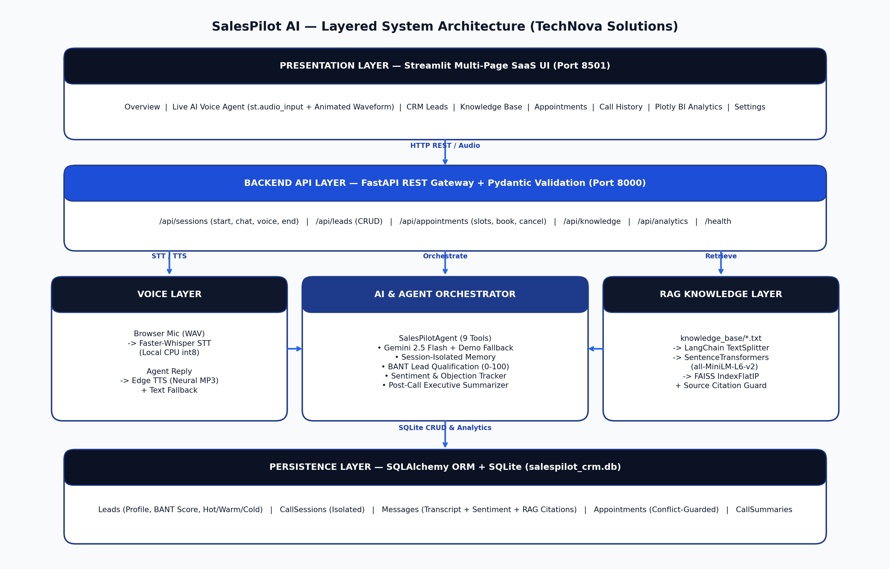

# SalesPilot AI — Autonomous AI Sales Voice Agent

**SalesPilot AI** is an industry-quality MVP of an autonomous AI sales voice representative built for **TechNova Solutions** (AI Automation, Cloud Services, Custom Software Development, and Business Intelligence).

It combines **FastAPI**, **Streamlit**, **Google Gemini API**, **Faster-Whisper (STT)**, **Edge TTS**, **LangChain + SentenceTransformers + FAISS (RAG)**, **SQLite CRM**, and **Plotly Analytics** in a modular, Windows-ready architecture.

---

## System Architecture



### Five-Layer Design
1. **Presentation Layer (`app.py`, `frontend/`):** 8-page Streamlit SaaS interface with a dark-navy/white theme, animated voice waveform, native browser mic input (`st.audio_input`), live lead-score gauges, and Plotly BI charts.
2. **API Gateway Layer (`backend/`):** FastAPI REST server with Pydantic v2 validation, dependency-injected SQLAlchemy sessions, and a `lifespan` startup hook.
3. **Voice Layer (`voice/`):** Local **Faster-Whisper** (`base`, CPU `int8`, VAD filter) Speech-to-Text with PyAV-safe WAV/container decoding, paired with **Edge TTS** (`en-US-AriaNeural`) neural speech synthesis.
4. **AI & RAG Layer (`ai_engine/`, `rag/`):** `SalesPilotAgent` orchestrates 9 tools powered by **Gemini 2.5 Flash** (with transparent `Demo Fallback Mode`), session-isolated memory, BANT qualification, sentiment/objection analysis, and **LangChain + SentenceTransformers (`all-MiniLM-L6-v2`) + FAISS (`IndexFlatIP`)** retrieval.
5. **Persistence Layer (`crm/`):** SQLAlchemy ORM over **SQLite** across 5 normalized tables (`Lead`, `CallSession`, `Message`, `Appointment`, `CallSummary`) with confirmation-gated booking and double-booking prevention.

---

## Key Features

- **Two-Way Voice & Text Sales Conversations:** Record directly from the browser microphone (`st.audio_input`), transcribe locally via **Faster-Whisper**, generate grounded responses, and play natural speech via **Edge TTS** — with a seamless text chat fallback.
- **Honest Fallback Modes:** Clearly displays `Live Gemini AI Active` vs `Demo Fallback Mode` in the UI and `/health` endpoint whenever `GEMINI_API_KEY` is absent or rate-limited — never pretending simulated replies are live LLM calls.
- **Grounded RAG Pipeline:** Loads `knowledge_base/*.txt`, splits via LangChain `RecursiveCharacterTextSplitter` (`chunk_size=500`, `chunk_overlap=80`), embeds via `all-MiniLM-L6-v2`, indexes in **FAISS `IndexFlatIP`**, cites sources (`[Source: pricing.txt]`), and enforces `min_score=0.22` to refuse hallucinating unknown facts.
- **Session-Isolated Contextual Memory:** Isolates conversation history by `session_id` (`sp-<hex>`) in SQLite and strictly preserves `null`/`Unknown` for unmentioned customer fields.
- **Transparent BANT Lead Qualification (0–100):** Scores Intent/Need (30), Budget Readiness (25), Timeline/Urgency (25), and Decision Authority (20) into **Hot** (70+), **Warm** (40–69), or **Cold** (<40) with explicit reasoning.
- **Real-Time Sentiment & Objection Tracking:** Classifies `Positive / Neutral / Negative` sentiment, engagement, purchase intent, urgency, and objections (Pricing, Data Privacy/Security, Integration, Timeline) across turns.
- **Confirmation-Gated Appointment Booking:** Checks open slots, requires explicit customer confirmation + valid name/email, prevents double-booking in SQLite, and supports cancellation.
- **8-Page SaaS Dashboard:**
  1. **Live AI Sales Agent** *(animated waveform, mic/text input, live BANT gauge, sentiment trajectory, tool trace)*
  2. **Overview Dashboard** *(live KPIs, stack health, recent leads, upcoming demos)*
  3. **CRM / Lead Management** *(search, Hot/Warm/Cold & status filters, transcript viewer, edit form)*
  4. **Knowledge Base** *(document viewer, live FAISS similarity tester, dynamic document ingestion)*
  5. **Appointment Management** *(slot availability checker, confirmation-guarded booking, cancellation)*
  6. **Call History** *(archived sessions, turn telemetry, executive post-call summaries)*
  7. **Analytics** *(Plotly BI charts computed 100% from live SQLite records)*
  8. **Settings** *(runtime Gemini API key, Edge TTS voice switcher, `/health` diagnostics)*

---

## Technology Stack

| Component | Technology | Role in SalesPilot AI |
|---|---|---|
| **Frontend UI** | Streamlit 1.55+ | 8-page SaaS workspace, `st.audio_input` mic capture, audio playback |
| **Backend API** | FastAPI + Uvicorn + Pydantic v2 | REST endpoints, schema validation, lifespan startup, `/docs` Swagger UI |
| **LLM Engine** | Google Gemini API (`gemini-2.5-flash`) | Grounded sales responses, JSON entity extraction, sentiment, summaries |
| **Speech-to-Text** | Faster-Whisper (`base`, `int8`) | Fast local CPU transcription with Silero VAD silence filtering |
| **Text-to-Speech** | Edge TTS (`en-US-AriaNeural`) | Natural neural MP3 synthesis streamed in memory |
| **RAG & Embeddings** | LangChain + `all-MiniLM-L6-v2` + FAISS | Chunking, 384-dim L2-normalized vectors, exact cosine search (`IndexFlatIP`) |
| **Database & ORM** | SQLite + SQLAlchemy 2.0 | Persistent CRM leads, sessions, messages, appointments, and call summaries |
| **Analytics & Charts** | Pandas + Plotly | Interactive lead, sentiment, service-demand, and daily/weekly call charts |

---

## Project Structure

```text
salespilot-ai/
├── app.py                     # Streamlit 8-page SaaS UI entrypoint
├── start_salespilot.bat       # One-click Windows launcher (FastAPI + Streamlit)
├── .streamlit/config.toml     # Enforced light SaaS theme palette
├── backend/
│   ├── config.py              # Pydantic settings (.env) & Windows OpenMP guards
│   ├── main.py                # FastAPI entrypoint & lifespan initialization
│   ├── routes/api.py          # REST API endpoints
│   └── schemas/api_schemas.py # Pydantic request/response validation models
├── frontend/                  # 8 UI pages + API client + CSS waveform theme
├── ai_engine/                 # SalesPilotAgent (9 tools), Gemini LLM client, memory, BANT, sentiment, summarizer
├── rag/                       # Document loader, SentenceTransformers embeddings, FAISS store, retriever
├── voice/                     # Faster-Whisper STT & Edge TTS engines
├── crm/                       # SQLite ORM models, CRUD, booking conflict checks, analytics queries
├── knowledge_base/            # TechNova Solutions domain documents
├── tests/                     # Unit & end-to-end API workflow tests (pytest)
├── docs/
│   ├── architecture.md        # Detailed layered architecture & 100k-user scaling guide
│   ├── system_architecture.png# Layered system architecture diagram
│   ├── PROJECT_REPORT.md      # One-page executive project report
│   └── INTERVIEW_STUDY_GUIDE.md # Deep-dive technical walkthrough & Q&A prep
├── .env.example
├── .gitignore
├── Dockerfile
├── pyproject.toml
└── requirements.txt
```

---

## Installation & Running on Windows (CMD)

### 1. Navigate to the project directory
```cmd
cd C:\Users\vvais\.gemini\antigravity\scratch\salespilot-ai
```

### 2. Create and activate a virtual environment (optional if packages are installed globally)
```cmd
python -m venv .venv
.venv\Scripts\activate
pip install -r requirements.txt
```

### 3. Configure environment variables
```cmd
copy .env.example .env
```
Open `.env` and add your Google Gemini API key (get one from [Google AI Studio](https://aistudio.google.com/app/apikey)):
```ini
GEMINI_API_KEY=your_actual_gemini_api_key_here
GEMINI_MODEL=gemini-2.5-flash
```
> **Note:** If `GEMINI_API_KEY` is left blank, SalesPilot AI runs cleanly in **Demo Fallback Mode** and displays a clear warning banner in the UI.

### 4. Launch the Application
**Option A — One-Click Launcher:**
```cmd
start_salespilot.bat
```
*(Automatically starts FastAPI, waits for `/health`, and launches Streamlit.)*

**Option B — Two Separate CMD Terminals:**
- **Terminal 1 (FastAPI Backend):**
  ```cmd
  uvicorn backend.main:app --host 127.0.0.1 --port 8000
  ```
  Swagger API docs: `http://127.0.0.1:8000/docs`
- **Terminal 2 (Streamlit Frontend):**
  ```cmd
  streamlit run app.py --server.port 8501
  ```
  Web UI: `http://localhost:8501`

---

## End-to-End 19-Step Workflow

1. Customer opens **Live AI Sales Agent** and clicks **Start New Sales Call**.
2. AI greets the prospect on behalf of **TechNova Solutions** via text and Edge TTS.
3. Customer speaks via browser mic (or types) asking about AI automation services.
4. Faster-Whisper transcribes audio locally to text.
5. `retrieve_company_information()` runs FAISS similarity search over `knowledge_base/`.
6. Agent replies with grounded TechNova facts and `[Source: ...]` citations.
7. Agent asks targeted discovery questions (requirements, budget, timeline, authority).
8. `extract_customer_details()` captures stated CRM fields (`null` when unknown).
9. `analyse_sentiment()` classifies sentiment, intent, urgency, and objections.
10. `qualify_lead()` computes a 0–100 BANT score (`Hot` / `Warm` / `Cold`) with reasoning.
11. Agent recommends a matching TechNova plan (Starter, Growth, or Enterprise).
12. Customer asks to schedule a meeting.
13. `check_appointment_availability()` returns open consultation slots.
14. Customer explicitly confirms date, time, name, and email.
15. `book_appointment()` validates confirmation and checks for conflicts before saving to SQLite.
16. `create_or_update_lead()` updates CRM status to `Demo Scheduled`.
17. User clicks **End Call & Save Summary**.
18. `generate_call_summary()` writes a structured brief into `CallSummary`.
19. **Analytics** and **Overview** dashboards update live from SQLite.

---

## API Documentation Summary

| Method | Endpoint | Purpose |
|---|---|---|
| `GET` | `/health` | System readiness, active LLM mode, embedding mode, KB chunk count |
| `POST` | `/api/sessions` | Start isolated voice/chat session & return greeting (+ optional TTS audio) |
| `GET` | `/api/sessions` & `/api/sessions/{id}` | List sessions or retrieve full transcript, lead profile, and summary |
| `POST` | `/api/sessions/{id}/chat` | Process text turn through agent + RAG + CRM + optional TTS |
| `POST` | `/api/sessions/{id}/voice` | Transcribe uploaded audio via Faster-Whisper & process agent turn |
| `POST` | `/api/sessions/{id}/end` | Generate & persist structured Call Summary to CRM |
| `POST` | `/api/tts` | On-demand Edge TTS synthesis |
| `GET/PATCH/DELETE` | `/api/leads` | Search, filter (`Hot`/`Warm`/`Cold`), inspect, update, and delete CRM leads |
| `GET/POST` | `/api/appointments` | Check slot availability, book (confirmation + conflict guard), and cancel |
| `GET/POST` | `/api/knowledge` & `/api/knowledge/query` | List KB docs, ingest new docs & rebuild FAISS, run semantic search |
| `GET` | `/api/analytics` | Live SQLite KPIs, lead/sentiment distributions, daily & weekly call activity |
| `GET` | `/api/calls/summaries` | List all post-call executive CRM summaries |
| `POST` | `/api/settings/config` | Update runtime Gemini key or Edge TTS voice in process memory |

---

## Testing Instructions

Run the complete unit and end-to-end test suite (`tests/test_modules.py` and `tests/test_e2e_workflow.py`):
```cmd
pytest -v
```
Tests verify:
- Hot/Warm/Cold BANT lead qualification & strict non-hallucinating entity extraction
- Sentiment analysis & objection detection
- FAISS RAG retrieval & anti-hallucination similarity threshold
- CRM CRUD & strict session isolation across concurrent sessions
- Confirmation-gated appointment booking & double-booking prevention
- Post-call summarization
- Complete end-to-end 19-step workflow & live SQLite analytics

---

## Scalability Strategy for 100,000 Users

> **Scope Note:** The local MVP runs single-node SQLite + local FAISS + in-process CPU Whisper for local evaluation. Scaling to **100,000 users** requires:

- **Horizontal Compute & Load Balancing:** Containerize FastAPI/UI pods in Docker on Kubernetes (EKS/GKE) behind an NGINX/ALB load balancer with Horizontal Pod Autoscaling (HPA).
- **Distributed Session Memory & Caching:** Use **Redis Cluster** for active conversation windows, rate limiting, and semantic caching of frequent FAQ/RAG answers (cutting LLM spend/latency by ~40–60%).
- **Production CRM Database:** Migrate SQLite to **Managed PostgreSQL** with `PgBouncer` pooling, read replicas for BI analytics, and row-level locking (`SELECT ... FOR UPDATE`) / unique partial indexes on `(appointment_date, appointment_time) WHERE status = 'Confirmed'`.
- **Distributed Vector Store:** Replace local `faiss-cpu` files with **Qdrant Cloud, Pinecone, or `pgvector`** using HNSW indexing and tenant isolation.
- **Async Voice Workers:** Offload Faster-Whisper transcription to **GPU worker pools (T4/L4)** fed by **RabbitMQ / Kafka / Celery** queues and WebRTC streaming.
- **Monitoring & Logging:** Prometheus + Grafana dashboards, OpenTelemetry tracing, and centralized structured JSON logging.

### Infrastructure & Operational Cost Considerations (100k MAU Estimate)
- **Kubernetes API/UI Nodes:** ~$400–$700/mo
- **Managed PostgreSQL + Redis Cluster:** ~$250–$450/mo
- **GPU Whisper Workers + Managed Vector DB:** ~$600–$1,200/mo (mitigated with VAD silence trimming + spot instances)
- **LLM & TTS API Usage:** Usage-based (~$0.002–$0.015 per conversation, reduced via Redis RAG caching)

---

## Data Security & Privacy Approach

- **Zero Hardcoded Secrets:** API keys loaded strictly from `.env` / environment variables; `.env` is excluded via `.gitignore`.
- **Strict Session Isolation:** Every conversation is scoped by `session_id` foreign keys so customer histories never cross-contaminate.
- **Input & DB Integrity:** Pydantic validation on all REST payloads, explicit customer confirmation + email/date validation, and SQLite conflict checks before appointment writes.
- **Production Hardening:** TLS 1.3 in transit, AES-256 at rest, Secrets Manager, OAuth2/JWT RBAC, and PII redaction before external LLM calls.

---

## Additional Documentation

- [Detailed Architecture & Scaling Spec](docs/architecture.md)
- [One-Page Executive Project Report](docs/PROJECT_REPORT.md)
- [Technical Interview Study Guide](docs/INTERVIEW_STUDY_GUIDE.md)
